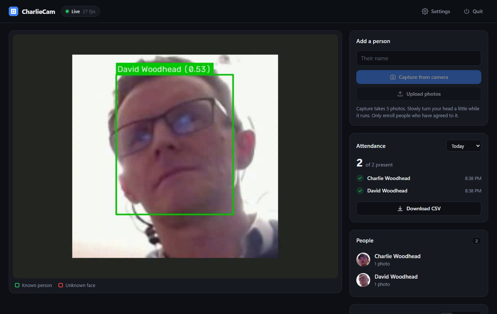

# CharlieCam

**A camera that takes attendance.** CharlieCam watches a webcam, recognises enrolled people
whether they are standing still or walking past, and keeps a per-meeting attendance record.
Add someone from one clear photo and they are recognised a moment later. No retraining, GPU
or cloud service needed.

Built for the CrabBots Software Lead Challenge: *"CrabBots meets every week, and someone has
to track who showed up. Make a camera do it for us."*



## How it works

```
 webcam / RTSP / video file  (camera thread: always the newest frame)
        │
        ▼
 ┌──────────────┐   ┌──────────────┐   ┌──────────────┐   ┌─────────────────┐
 │ YuNet        │──▶│ SFace        │──▶│ FaceDatabase │──▶│ IdentityTracker │
 │ find faces + │   │ align, 128-d │   │ cosine match │   │ keeps the name  │
 │ 5 landmarks  │   │ embedding    │   │ vs threshold │   │ on blurry frames│
 └──────────────┘   └──────────────┘   └──────────────┘   └────────┬────────┘
                                         no match → UnknownRegistry │ ("Unknown #3" stays #3)
                                                                    ▼
                         ┌────────────────────────────────────────────────────┐
                         │ EventRecorder: 10 s cooldown per identity           │
                         │   → data/events.jsonl   (+ snapshot of unknowns)    │
                         └───────────────┬────────────────────────────────────┘
                                         ▼
                 Attendance view: first/last seen per person per day, CSV export
```

1. **Capture.** A background thread reads the camera continuously and keeps only the latest
   frame, so a slow step never builds up lag.
2. **Detect: YuNet.** A small CNN finds every face plus five landmarks (eyes, nose, mouth
   corners). Faces under 40 px are ignored because they are too blurry to trust.
3. **Embed: SFace.** The landmarks align the face to a canonical pose, then SFace turns it
   into a 128-number vector. Two photos of the same person give vectors that point the same way.
4. **Match.** Cosine similarity against every stored vector in one NumPy matrix product. The
   best score must reach 0.363, OpenCV's published SFace threshold (adjustable in Settings).
   Each person can have several vectors (angles, lighting); the closest one counts.
5. **Track.** When someone walks past, some frames are too smeared to match. If such a face
   overlaps the box of a person confidently matched in the last second, it keeps that name
   (see [the benchmark](#walking-past-benchmark)).
6. **Record.** Each identity is logged at most once per cooldown window to an append-only
   JSON-lines file, and unknown faces get a snapshot. Attendance is a view computed from that
   log: there is one source of truth and no second store to drift out of sync.

## Quick start (Windows, PowerShell)

```powershell
git clone https://github.com/<your-username>/charliecam.git
cd charliecam
py -m venv .venv
.\.venv\Scripts\Activate.ps1          # if blocked: Set-ExecutionPolicy -Scope Process Bypass
pip install -e ".[dev]"
charliecam download-models            # ~40 MB, once (also automatic on first launch)
charliecam web                        # opens http://127.0.0.1:8000
```

macOS/Linux: same commands, but activate with `source .venv/bin/activate`.
Or double-click **`CharlieCam Web.pyw`** (no console window; uses the project's `.venv`).

## Live demo script

1. `charliecam web`. The page opens and the status pill turns green ("Live").
2. Type a name, click **Upload photos**, and pick one clear photo of that person.
3. Hold the photo up to the camera, or have the person walk past: a green box with their
   name appears, and they show up under **Attendance → Today**.
4. A face that isn't enrolled gets a red "Unknown #N" box, and a snapshot appears in **Activity**.
5. **Download CSV** exports the attendance list for the meeting.

## The web app

- **Live view** with green (known) and red (unknown) boxes, streamed as MJPEG.
- **Add a person:** type a name, then **Capture from camera** (5 photos taken automatically,
  only when exactly one face is in view, nothing saved until all 5 are captured) or **Upload
  photos**.
- **Attendance:** who is present for the chosen day, when each person was first seen, who is
  still missing, and a CSV download. Past meeting days are in the date menu.
- **People:** thumbnails and photo counts. Removing someone also deletes their photos.
- **Activity:** a live feed of sightings that you can filter to unknown faces. Click a
  snapshot to enlarge it.
- **Settings:** match strictness and repeat-alert delay, saved to `data/web_settings.json`.
- **Quit** stops the server and releases the camera. Starting CharlieCam while it is already
  running just reopens the page.

By default only this PC can open the page. `charliecam web --host 0.0.0.0` lets phones on the
same network view it. Anyone on that network can then see the camera and enrolled faces.

There is also a desktop window (`charliecam gui` / `CharlieCam.pyw`) and a command-line mode.

## Commands

| Command | What it does |
|---|---|
| `charliecam web [--source 0] [--host 127.0.0.1] [--port 8000] [--no-browser]` | Browser app |
| `charliecam gui [--source 0]` | Desktop app |
| `charliecam attendance [--date 2026-11-23] [--csv out.csv]` | Attendance report for a day |
| `charliecam enroll NAME [IMAGES...] [--camera --samples N]` | Add a person from photos or the webcam |
| `charliecam list` / `charliecam remove NAME` | Manage enrolled people |
| `charliecam run [--source 0\|rtsp://...\|file.mp4] [--cooldown 10] [--every 2] [--no-window]` | Headless/console recognition |
| `charliecam download-models` | Fetch the YuNet and SFace ONNX models into `models/` |
| Global: `--threshold 0.363`, `--data-dir data`, `--models-dir models` | Tuning and paths |

`--source` accepts a webcam index, an RTSP URL or a video file, so a recorded demo replays
exactly like a live one.

## Design decisions

- **Embeddings + nearest neighbour, not a trained classifier.** Attendance is an open-set
  problem: the system must be able to say "none of the above", and new members arrive every
  week. Comparing embeddings to a threshold handles both. Adding a person is one vector, with
  no retraining, which is what makes the live "upload a photo" demo instant.
- **OpenCV YuNet + SFace.** One `pip install opencv-python` and no dlib/CMake build, so it
  installs cleanly on a club laptop. Both models run in real time on a CPU (about 25–30 fps
  at 640×480 in testing).
- **Track to handle walking past.** Recognition runs on every frame; the tracker only bridges
  frames that fail to match. The hold is measured from the last *real* match and is never
  extended by a held frame, so a stranger who steps into the same spot is labelled correctly
  within a second.
- **Stable IDs for strangers plus a per-identity cooldown.** One unknown person standing
  in view produces one alert and one snapshot, not thirty a second.
- **Attendance computed from the event log.** The log is append-only and human-readable, can
  be replayed for any past meeting, and can't disagree with itself.
- **Service layer separated from HTTP.** `web/service.py` has no web code, and
  `web/server.py` is a thin FastAPI wrapper. Tests drive the service directly and the API
  through FastAPI's test client.
- **Dependency inversion for testability.** The pipeline depends on `FaceDetector` and
  `FaceEmbedder` protocols. Tests use fakes where a "face" is a coloured square and its colour
  is the embedding, so matching, tracking, enrollment, events, attendance, the CLI, the GUI
  and the web API are all tested deterministically with no camera or model files. Three
  smoke tests also run the real models.
- **Safe by default.** The server listens on localhost only. Changes need a custom
  `X-CharlieCam` header, which other websites can't send without a CORS preflight that this
  server never approves. Snapshot paths are checked against directory traversal. Database
  writes are atomic (temp file + rename), and enrollment commits all photos or none.
- **No front-end build step.** Plain HTML, CSS and JavaScript served by FastAPI. Nothing to
  `npm install`, and the page works offline.

## Walking-past benchmark

`tools/walk_benchmark.py` enrolls one photo of a person, then slides their other photos across
the frame over 40 frames with heavy horizontal motion blur on a random half of the frames. It
runs the same clips with the tracker off and on:

```powershell
python tools/walk_benchmark.py data/faces/<Person_Name>
```

On the author's photos: **78.4% → 99.5%** of frames correctly named, and false "Unknown"
identities fell from 8 to 1. This is a synthetic test, useful for tuning but not a field
accuracy figure.

## Testing

```powershell
pytest               # 114 tests, about 2 s
ruff check src tests # lint
```

CI (GitHub Actions) runs lint and tests on Windows and Linux with Python 3.11 and 3.12,
including the real-model smoke tests.

## Project layout

```
src/charliecam/
  types.py        value objects: BoundingBox, Detection, MatchResult, RecognizedFace
  engines.py      FaceDetector / FaceEmbedder protocols + YuNet / SFace implementations
  database.py     embedding store, vectorised cosine matching, atomic save/load
  pipeline.py     frame -> recognised faces; IdentityTracker; UnknownRegistry
  events.py       event log + snapshots, per-identity cooldown
  attendance.py   per-day attendance report and CSV, computed from the event log
  enrollment.py   guided capture: N samples, exactly one face, all-or-nothing commit
  camera.py       capture (DirectShow on Windows), camera thread, console live loop
  models.py       model download and background pipeline loading
  overlay.py      boxes and labels
  cli.py          command-line entry point
  web/            service.py (logic) · server.py (FastAPI) · app.py (startup) · static/ (page)
  gui/            desktop window: Pillow-drawn view, controller, theme
tools/walk_benchmark.py   tracker benchmark
tests/                    unit, integration and real-model smoke tests
CharlieCam Web.pyw / CharlieCam.pyw   double-click launchers
```

Data stays in `data/`: face photos in `data/faces/<name>/`, the database in `data/faces.npz`,
sightings in `data/events.jsonl`, unknown snapshots in `data/snapshots/`, and errors in
`data/charliecam.log`.

## Limitations and next steps

- **No liveness check.** A printed photo can match. That is fine for an attendance demo but
  not for access control.
- **Profile views and faces smaller than 40 px are not recognised.** Mount the camera at face
  height near the door, where people walk *toward* it.
- **Threshold.** Calibrate it on the real camera with a small labelled set (an ROC curve)
  instead of relying only on the published default.
- **Scale.** The linear scan suits a club (it is fine up to ~100k vectors). Beyond that, use
  FAISS or pgvector.
- **Meetings are calendar days.** Supporting more than one meeting a day would need session
  start/stop times.

## Privacy

Face embeddings are biometric data, and laws such as GDPR and Illinois BIPA require consent
and retention limits. `data/` and `models/` are git-ignored, so no enrolled photos,
embeddings or sighting logs reach the repository. Only enroll people who have agreed to it.

## License

Code: MIT. Models from OpenCV Zoo: YuNet (MIT), SFace (Apache-2.0). `docs/flier.html` is the source of `docs/CharlieCam-flier.pdf` (print it to PDF from a browser).
